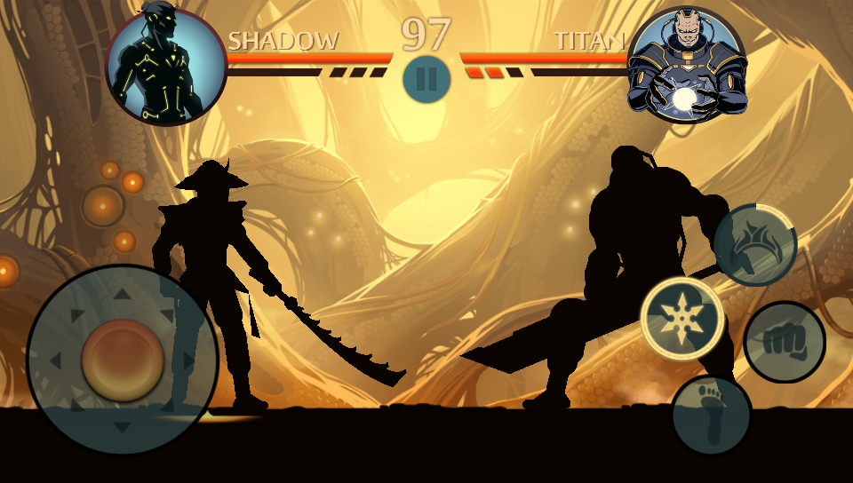
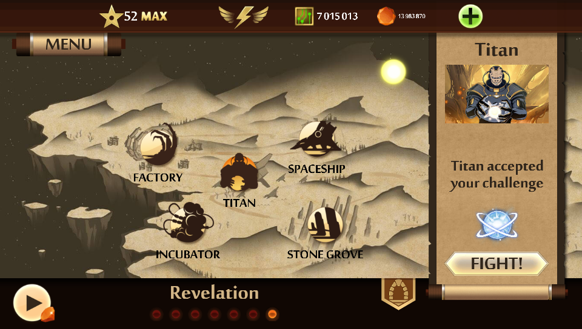
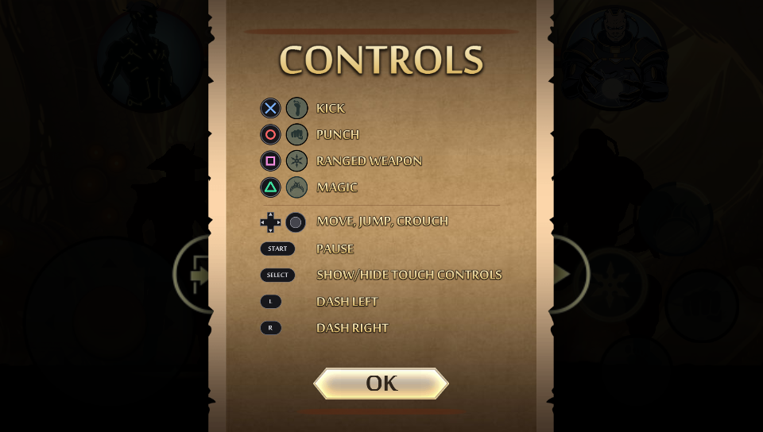

# Shadow Fight 2 for PS Vita



An unofficial port of *Shadow Fight 2* 1.9.38 (Nekki) to the PlayStation Vita.

This isn't a remake. The game's original ARM code runs unmodified on the Vita,
and this project supplies everything underneath it: a loader for the game's
executable and a replacement for the Android runtime it was built on. You
provide the game from your own copy of the APK. Nothing in this repository or
its releases will run without it.

- The full single-player game, including every act and its content packs.
- Physical controls in fights, with the on-screen buttons still available.
- Offline only. Pop-ups for offers, ads, Facebook and news are removed.
- An optional cheats panel in the shop. It's on by default.



## Controls

| Button | In a fight |
|---|---|
| Cross | Kick |
| Circle | Punch |
| Square | Ranged weapon |
| Triangle | Magic |
| Left stick or d-pad | Move, jump, crouch |
| L / R | Dash left / right |
| Start | Pause |
| Select | Show or hide the touch controls |

Menus, the map and the shop use the touchscreen. That also means a PlayStation
TV can't get through the menus, so it isn't supported.

The pause menu has a page showing these controls:



## Installing

You'll need:

- A Vita with HENkaku or Ensō, and [VitaShell](https://github.com/TheOfficialFloW/VitaShell).
- About 400 MB free on `ux0:`.
- The Android APK of Shadow Fight 2 **1.9.38** (versionCode 1000109, armeabi-v7a).
  No other version will work, because the port patches fixed addresses in the
  game's code. This project doesn't link to APKs, so you'll have to supply it.
- A PC with Linux or WSL, Python 3 and `curl`, to prepare the game data.

### 1. Set up the Vita

These only need doing once.

1. Download `kubridge.skprx` from the
   [kubridge releases](https://github.com/bythos14/kubridge/releases) and copy it
   to `ux0:tai/`.
2. Add it under `*KERNEL` in `ux0:tai/config.txt`, then reboot:
   ```
   *KERNEL
   ux0:tai/kubridge.skprx
   ```
3. Install and run [ShaRKBR33D](https://github.com/Rinnegatamante/ShaRKBR33D). It
   extracts `ur0:data/libshacccg.suprx`, the shader compiler the game needs.

### 2. Install the VPK

Get `ShadowFight2.vpk` from the [Releases](../../releases) page, copy it to the
Vita and install it with VitaShell.

### 3. Prepare the game data

```sh
git clone https://github.com/franciscoclou/shadowfight2-vita.git
cd shadowfight2-vita
mkdir apk && unzip /path/to/shadowfight2-1.9.38.apk -d apk
sha256sum apk/assets/ShadowFight2.s3e
./scripts/prepare_game.sh
./scripts/fetch_packs.sh
```

The `sha256sum` line should print:

```
4b22b4f9255e138d0c7bdfb8cc08eb451411fa9719f3123b99954301697048e7
```

If it doesn't, you have a different build of the game and the port won't run it.

`prepare_game.sh` unpacks the game from the APK. `fetch_packs.sh` downloads about
300 MB of content packs from Nekki's own servers, the same files the Android game
downloads for acts 2 onward. The packs aren't hosted here, so this step only works
for as long as Nekki keeps serving them.

### 4. Copy it to the Vita

Copy everything *inside* `game_out/` to `ux0:data/shadowfight2/`, over USB or FTP
with VitaShell. You should end up with
`ux0:data/shadowfight2/ShadowFight2.s3e.raw` and the rest beside it.

Then start the game from the LiveArea. The first launch and the first visit to
each stage are slower, because shaders compile the first time and are cached on
the memory card after that.

## If it doesn't start

The game explains most setup problems on screen:

| Message | Fix |
|---|---|
| `libshacccg.suprx is missing` | Run ShaRKBR33D (step 1.3) |
| `kubridge.skprx is not loaded` | Check `config.txt` and reboot (step 1.2) |
| `ShadowFight2.s3e.raw is missing` | Copy the game data to the right folder (step 4) |
| VPK install fails at 99% with `0x8010113D` | The LiveArea art was changed to a non-palette PNG. Only affects custom builds |

For anything else, open an issue and attach `ux0:data/shadowfight2/debug.log`. The
log is rewritten on every launch, so copy it before starting the game again. If
the game crashed, include the newest `ux0:data/psp2core-*.psp2dmp` as well.

## Settings

The game writes `ux0:data/shadowfight2/controls.txt` on its first launch. Edit it
to change these, and delete it to restore the defaults.

| Setting | Default | What it does |
|---|---|---|
| `cheats` | `1` | Unlimited energy, and a shop button to a panel with coins, gems, currencies, a level up and a progress reset |
| `remove_online` | `1` | Stops pop-ups that need the internet from opening |
| `touch_controls` | `0` | Shows the on-screen fight controls. Select also toggles this during a fight |
| `joystick`, `punch`, `kick`, ... | | Screen positions the physical buttons press |

`cheats` and `remove_online` take effect at the next launch.

Your save is in `ux0:data/shadowfight2/ram/`. Copy that folder if you want a
backup. Reinstalling the VPK doesn't touch it, and the cheats panel's RESET
PROGRESS button deletes it after asking you to confirm.

## What doesn't work

Anything that needs a server or a store. Multiplayer, purchases and ads are all
gone, and their leftover buttons show the game's "no connection" message. The
release build doesn't use the network at all, so the cheats only change your local
save.

## Legal

**This repository and its releases contain no APK, no game code and no game data.**
You have to own the game and supply it yourself. The port does nothing without it.

Three things here do come from the game's artwork. The first two are in the VPK
because the port needs them, and the third is only in this repository:

- `sce_sys/`: the LiveArea icon and background, made from the game's key art.
- `src/assets/`: the port's controls and pause screens, drawn with the game's font
  and icons. These are built into `eboot.bin`.
- `docs/shots/`: screenshots of the game running on a Vita.

This project isn't affiliated with, endorsed by, or connected to Nekki. *Shadow
Fight* and its artwork, characters and code belong to Nekki. If you represent Nekki
and have a concern about this project, please open an issue.

## Building

Docker is the only requirement, because the toolchain runs inside it. The first
build also builds the image, which takes a while.

```sh
./scripts/build.sh          # -> build/ShadowFight2.vpk
./scripts/build.sh clean    # from scratch
./scripts/build.sh verbose  # with per-frame logging
./scripts/build.sh release  # the public build -> build-release/ShadowFight2.vpk
```

A normal build also sends its log over UDP to your network, on port 18194. Set
`PC_IP` in `scripts/env.local.sh` to send it to one PC as well as broadcasting it.
A release build skips the network and writes only
`ux0:data/shadowfight2/debug.log`.

`shadowfight2` in the build folder is the unstripped ELF. Keep the one that matches
your build, because crash dumps can't be read without it.

### How it works

Shadow Fight 2 is built on the Marmalade SDK, so the game isn't in the APK's `.so`
files. Those are Marmalade's Android runtime. The game itself is
`assets/ShadowFight2.s3e`, an LZMA stream holding a Marmalade `XE3U` executable
whose imports are resolved by name.

- `src/loader/` parses that format, maps the image with kubridge and fills in its
  imports.
- `src/s3e/` replaces `libs3e_android.so`, implementing the s3e API on Vita APIs
  and vitaGL. It also holds the patches and the port's own UI.
- `src/platform/` is the thin layer over the Vita itself.

[docs/RE_NOTES.md](docs/RE_NOTES.md) records the formats, addresses and game
behaviour found so far, all for this one build. `scripts/s3e_info.py` dumps an
image's header, imports and veneers, and can rewrap it as an ELF for Ghidra.

## Credits

- [Nekki](https://www.nekki.com/), for the original game.
- [Rinnegatamante](https://github.com/Rinnegatamante), for vitaGL, vitaShaRK and
  ShaRKBR33D.
- [TheOfficialFloW](https://github.com/TheOfficialFloW), for kubridge, VitaShell
  and the `.so` loader approach this port follows.
- [bythos14](https://github.com/bythos14), for the kubridge version used here and
  SceShaccCgExt.
- [VitaSDK](https://vitasdk.org/), the toolchain.

## Licence

The port's source code is [MIT licensed](LICENSE). That covers this project only,
not *Shadow Fight 2* or anything extracted from it.

The VPK also contains these libraries, under their own licences:

| Library | Licence |
|---|---|
| [vitaGL](https://github.com/Rinnegatamante/vitaGL) | LGPL-3.0 |
| [vitaShaRK](https://github.com/Rinnegatamante/vitaShaRK) | LGPL-3.0 |
| [SceShaccCgExt](https://github.com/bythos14/SceShaccCgExt) | LGPL-2.1 |
| [math-neon](https://github.com/Rinnegatamante/math-neon) | MIT |
| [zlib](https://zlib.net/) | zlib |
| [minimp3](https://github.com/lieff/minimp3) | CC0-1.0 |

To use a modified copy of an LGPL library, change it in
[docker/Dockerfile](docker/Dockerfile), which pins the exact vitaGL and vitaShaRK
commits, and rebuild.
